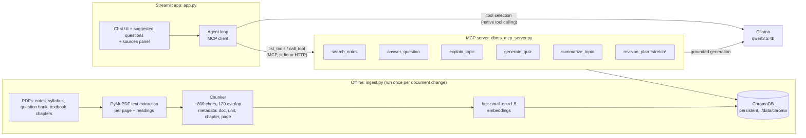

# DBMS Study Assistant: Project Specification

**Project:** Subject-specific AI teaching assistant for *Database Management Systems*
**Basis:** FDP Participant Project Guide (Sarveshwar Academy / Knowledge Institute of Technology)
**Author:** Walter · **Spec version:** 1.0 · **Date:** 2026-10-09
**Target:** Runs locally on a CPU-only Windows laptop with 8 GB RAM; published as a GitHub portfolio repo.

---

## 1. Summary

A local chatbot that answers DBMS questions from Walter's own notes and selected textbook chapters, cites the document and page for every answer, explains hard concepts simply, generates five-question MCQ quizzes, and says "I do not have this information" when the material does not cover a question.

It is built in plain Python in four layers, each a learning goal in itself:

| Layer | What it teaches | Technology |
|---|---|---|
| Ingestion | PDF extraction, chunking, metadata | PyMuPDF, a small custom chunker |
| Retrieval (RAG) | Embeddings, vector search, grounded prompting | sentence-transformers + ChromaDB |
| Agent + tools (MCP) | Tool schemas, tool selection, MCP client/server | Official `mcp` Python SDK (v2) + Ollama tool calling |
| Interface | Chat UI, session state, streaming | Streamlit |

The guide's rule drives every decision in this spec: *a simple chatbot that gives correct answers and clearly shows its sources scores higher than a fancy agent that gives unsupported answers.* RAG is built and tested first; the agent layer comes second.

---

## 2. Requirements (traced to the guide)

### 2.1 The five mandatory capabilities (guide §6)

| # | Capability | Acceptance test | Implemented by |
|---|---|---|---|
| C1 | **Ask**: answers from course documents | Ask "What is a candidate key?" and the answer matches the notes | `answer_question` tool (RAG) |
| C2 | **Explain**: simplifies hard concepts | "Explain BCNF to a first-year student" gives a simple explanation with an analogy and example, still grounded | `explain_topic` tool |
| C3 | **Practice**: five MCQs with answers and explanations | "Quiz me on transactions" gives exactly 5 MCQs, 4 options each, correct answer plus a one-line explanation, all from retrieved chunks | `generate_quiz` tool |
| C4 | **Reference**: shows source document and page | Every answer ends with a sources list (`file, chapter, p. N`) and the UI shows the retrieved passages | Citation formatter + sources panel |
| C5 | **Admit limitations** | "Who won the 2022 World Cup?" or an out-of-syllabus DBMS topic gives the refusal line | Retrieval score threshold + prompt rule |

### 2.2 Advanced / agent features (guide step 6, rubric 15 marks)

At least one is required. Plan: two in the core build, one stretch.

- **Core:** quiz generation (C3) and lesson summarization (`summarize_topic`).
- **Core:** agent-based tool selection, where "quiz me", "summarize unit 3" or "explain 2PL" pick the right tool without buttons.
- **Stretch:** `revision_plan` builds a day-by-day revision schedule from the syllabus units and an exam date.

### 2.3 Non-functional requirements

| Area | Requirement |
|---|---|
| Hardware | Peak RAM use for the whole stack (Ollama + app) stays at or below about 5 GB, leaving room for Windows and a browser |
| Latency (CPU) | First token within about 15 s for a normal question; full answer within about 60 s; quiz within about 2 min. Responses stream so the student sees progress |
| Grounding | The model answers only from retrieved passages; no passage above the relevance threshold means a refusal |
| Privacy | Everything runs offline locally. No student records. Only authorized materials (guide §11) |
| Copyright | Textbook PDFs and their derived vector store are **never committed** to the public repo (see §9) |
| Portability | LLM and embedding providers are swappable by config, so the same code can later run on a free host (§12) |

---

## 3. Hardware budget and model selection

### 3.1 Memory budget (8 GB, no GPU)

| Consumer | Approx. RAM |
|---|---|
| Windows 11 + background | 2.5–3.0 GB |
| Browser tab (Streamlit UI) | 0.3–0.5 GB |
| Python app (Streamlit, ChromaDB, embedding model) | 0.5–0.7 GB |
| **Ollama chat model (4B, Q4, 4k context)** | **3.0–3.5 GB** |
| **Total** | **about 6.5–7.5 GB** |

This fits, but only just. That leads to these rules:

- Only **one** LLM loaded at a time (`OLLAMA_MAX_LOADED_MODELS=1`, `OLLAMA_NUM_PARALLEL=1`).
- Context window capped at **4096 tokens** (`num_ctx: 4096`). Larger contexts grow RAM and slow CPU prompt processing.
- Embeddings run in the Python process with a tiny model rather than as a second Ollama model, so Ollama never swaps between models mid-request.
- Close heavy apps (IDE indexers, other Electron apps) while demoing.

### 3.2 Chat model recommendation

Check exact tags and sizes first with `ollama list` and `ollama show <model>`.

| Role | Model | Why |
|---|---|---|
| **Primary** | **`qwen3.5:4b`** (Q4 quantization, about 3 GB) | Best quality that fits. Good instruction following, supports Ollama native tool calling and JSON-schema structured output. **Run with thinking disabled** (`think=False`), because reasoning tokens would roughly double CPU response time |
| Fallback (speed) | `qwen2.5:3b` or `qwen2.5:1.5b` | If the 4B is too slow on your CPU. 1.5B is fast but noticeably weaker at MCQ generation |
| Comparison only | `gemma4` small variant (the E2B/E4B-class edge sizes), if that is what you have | Worth one evaluation run against the same 20 test questions. Use whichever scores higher in the test log |
| **Avoid** | `qwen3.5:latest` and any model at or above 7B | The `latest` tag usually points at a larger default size. On 8 GB with no GPU it will swap or crawl. Confirm its size with `ollama show qwen3.5` |

Expected CPU speed for a 4B Q4 model on a modern laptop CPU is about 5–12 tokens/s generation and 30–80 tokens/s prompt processing. That is why retrieved context is kept small (§5.3).

### 3.3 Embedding model recommendation

| Choice | Model | Size | Notes |
|---|---|---|---|
| **Recommended** | **`BAAI/bge-small-en-v1.5`** via `sentence-transformers` | about 130 MB, 384-dim | Strong retrieval quality for its size, fast on CPU, and the same code runs on a free cloud host where Ollama is unavailable. Matches the guide's "Sentence Transformers" option |
| Lighter alternative | `sentence-transformers/all-MiniLM-L6-v2` | about 90 MB, 384-dim | Slightly weaker retrieval, slightly faster |
| Ollama alternative | `nomic-embed-text` | about 275 MB | Fine locally, but it forces Ollama to swap models between embedding and chatting, and it can't move to a free host |

Install the **CPU-only** PyTorch wheel before `sentence-transformers` to avoid a 2 GB+ CUDA download:
`pip install torch --index-url https://download.pytorch.org/whl/cpu`

---

## 4. Architecture



### 4.1 Request flow

1. The student types a message in Streamlit.
2. The **agent loop** (MCP client) fetches the tool list from the MCP server and sends the message plus tool schemas to Ollama.
3. The model picks a tool, for example `generate_quiz(topic="transactions")`. If it calls no tool, the agent defaults to `answer_question`.
4. The MCP server runs the tool: it retrieves top-k chunks from ChromaDB, checks the relevance threshold, builds a grounded prompt, and calls Ollama.
5. The tool returns structured output (`answer`, `sources[]`, `refused: bool`, or `quiz[]`).
6. Streamlit renders the answer, the citations, and an expandable "Retrieved passages" panel.

### 4.2 Why MCP, and how it stays simple

MCP (Model Context Protocol) is used here as the *tool contract* between the agent and the course-knowledge capabilities.

- The tools live in one MCP server built with **`MCPServer`** from the official `mcp` SDK (v2; it was called FastMCP in v1, which most tutorials still show). Each tool is a typed Python function with a docstring, and the SDK generates the JSON schema.
- The Streamlit agent is an **MCP client**. It converts the server's tool schemas into Ollama's `tools=[...]` format, so tool selection is real model-driven tool calling, not hard-coded `if` statements.
- **Portfolio bonus:** the same server can be plugged into any MCP-capable desktop client (for example Claude Desktop or VS Code) to query your DBMS notes, which is a nice demo point.

Keep the tool *implementations* in a plain module (`dbms_bot/tools.py`) and make the MCP server a thin wrapper. Unit tests and a "direct mode" (no MCP, in-process calls) then come for free, which helps when debugging.

**Transport:** start with **stdio**, where the client spawns the server. If spawning the server per request feels slow, because it reloads the embedding model each time, switch to **streamable HTTP**: run `python -m dbms_bot.mcp_server --http` once in a second terminal on `localhost:8765`, and Streamlit connects to it on each request.

### 4.3 Making tool selection reliable on a 4B CPU model

Small models sometimes skip or garble tool calls. Use this layered approach and record which layer fired in the logs:

1. **Native tool calling** via `ollama.chat(..., tools=..., think=False)` with short, distinct tool descriptions.
2. **Validation:** if the tool name is unknown or the arguments fail Pydantic validation, retry once with the error message attached.
3. **Keyword fallback router:** `quiz|mcq|test me` routes to quiz, `summar|overview|recap` routes to summary, `explain|simple|eli5|beginner` routes to explain, anything else to `answer_question`.

This satisfies the guide's quick check ("If a student types 'quiz me', does the assistant pick the quiz tool on its own?") reliably, while still demonstrating genuine agent behaviour.

---

## 5. RAG pipeline design

### 5.1 Extraction (guide step 2)

- **PyMuPDF** (`pymupdf`), one record per page: `{doc_id, file_name, doc_type, page, text}`.
- `doc_type` is one of `syllabus | notes | question_bank | textbook`, set from the subfolder name, and is used for filtering and source display.
- Detect chapter and unit headings with a regex (`^(Unit|Chapter|Module)\s+\w+`) and carry the current heading forward as metadata.
- Strip repeated headers and footers (lines that appear on more than 50% of pages) and page numbers.
- Scanned PDFs with no text layer are flagged and skipped in v1. OCR is a later option, and too heavy for this machine during the build.

### 5.2 Chunking

- Recursive split on paragraph, then line, then sentence boundaries. Target **about 800 characters (about 200 tokens), 120-character overlap**.
- Never split a chunk across documents. Store `page_start` and `page_end` when a chunk spans pages.
- Keep SQL code blocks and tables intact where possible, because DBMS notes are full of them.
- Chunk ID: `{doc_id}:{page}:{n}`, so re-ingesting is idempotent (`collection.upsert`).
- You can write this splitter yourself in about 40 lines, which is a good learning exercise, or use `langchain-text-splitters`' `RecursiveCharacterTextSplitter` without pulling in all of LangChain.

### 5.3 Retrieval

- Embed the query with the same model. Use the bge query instruction prefix: `"Represent this sentence for searching relevant passages: "`.
- ChromaDB cosine similarity, **top_k = 4** (about 800 tokens of context). This keeps CPU prompt processing to about 15 s.
- **Relevance threshold:** if the best chunk's cosine similarity is below about 0.45, return the refusal without calling the LLM. Tune the exact value from test log type C questions. This is the main defense for capability C5, and it saves a slow LLM call.
- Optional, only if test results show a need: hybrid search (BM25 via `rank-bm25` combined with vectors) helps exact-term queries like "ACID" or "3NF".

### 5.4 Grounded generation prompt (core of C1, C4 and C5)

```
You are a DBMS teaching assistant for {course_name}.
Answer ONLY using the numbered context passages below.
If the passages do not contain the answer, reply exactly:
"I do not have this information in the course material."
Cite passages inline like [1], [2]. Keep answers under 200 words unless asked.

Context:
[1] ({file_name}, {chapter}, p.{page}) {text}
[2] ...

Question: {question}
```

The app maps `[n]` markers back to source metadata and shows a clean source list. Ollama options: `temperature: 0.2`, `num_ctx: 4096`, `num_predict: 512` (1024 for quizzes).

### 5.5 Quiz generation (C3)

- Retrieve top 6 chunks for the topic.
- Use Ollama **structured output** (`format=<JSON schema>`) for 5 items: `{question, options[4], answer_index, explanation, source_ref}`.
- Validate with Pydantic. If validation fails, retry once, then fall back to showing the raw text.
- The UI renders the quiz with `st.radio` per question and a "Check answers" button, which is a great Streamlit learning exercise.

---

## 6. Source material: what to ingest

> **Note:** this spec was written without access to the `notes` and `textbooks` subfolders, because the folder could not be opened from the session that wrote it. The rules below decide the subset. Apply them with `scripts/inventory.py` (§8), which prints page counts and text-layer status for every PDF.

Ingestion volume is **not** the main hardware constraint. Embedding about 5,000 chunks with bge-small on CPU takes about 5–10 minutes once, and ChromaDB handles it easily. The real constraints are **retrieval quality**, since overlapping textbooks dilute results, and **copyright** for the public repo. So:

| Priority | Ingest | Reason |
|---|---|---|
| **Tier 1 (always)** | Syllabus and course outcomes; your own lecture notes for every unit; question bank / previous papers | Highest relevance, matches how students ask, and yours to publish |
| **Tier 2 (selectively)** | **One** primary textbook, and only the chapters that map to syllabus units (typically: intro and architecture, ER model, relational model and algebra, SQL, normalization, transactions and concurrency, recovery, indexing and hashing, query processing) | Fills gaps the notes skip. One book avoids conflicting notation |
| **Skip in v1** | Second and third textbooks covering the same topics; scanned PDFs without a text layer; appendices, exercises-only chapters, bibliographies, index pages | Duplicates hurt top-k diversity; scans need OCR |
| **Phase 2** | A second textbook's chapters for topics your notes and primary book cover thinly (for example NoSQL or distributed DBs, if in the syllabus) | Add only if test log type B questions show gaps |

The guide asks for "5 to 10 documents to start", which Tier 1 plus one textbook satisfies.

---

## 7. Tools and technology

### 7.1 Software stack

| Component | Choice | Guide § |
|---|---|---|
| Language | Python 3.11 or 3.12 (avoid 3.13 if any wheel is missing) | §5 |
| Env / packages | `venv` + `pip` with `requirements.txt` (or `uv` if you want faster installs) | — |
| PDF processing | `pymupdf` | §5 |
| Embeddings | `sentence-transformers` + CPU `torch`; model `BAAI/bge-small-en-v1.5` | §5 |
| Vector DB | `chromadb` (persistent client) | §5 |
| LLM runtime | Ollama, `qwen3.5:4b` (fallback `qwen2.5:3b`) | §5 |
| LLM client | `ollama` Python package | — |
| Agent protocol | `mcp` v2 (official SDK, `MCPServer` + client) | §5 (agent, optional) |
| Validation | `pydantic` | — |
| Config | `pydantic-settings` + `.env` (`python-dotenv`) | — |
| UI | `streamlit` | §5 |
| Testing | `pytest`; a custom eval script that writes the test log CSV | §4 step 7 |
| Code quality | `ruff` (lint + format) | — |
| Version control | Git + GitHub | — |
| Diagram | Mermaid (renders on GitHub) | §8 |

**Framework choice:** the guide lists LangChain or LlamaIndex. This spec deliberately uses **no orchestration framework**, because you want to implement the agent yourself and every step stays visible and explainable at the demo. LangGraph is the documented upgrade path if the agent grows multi-step. Mention this decision in the report.

### 7.2 `requirements.txt` (starting point)

```
pymupdf
sentence-transformers
chromadb
ollama
mcp>=2.2,<3
pydantic
pydantic-settings
python-dotenv
streamlit
pytest
ruff
```

### 7.3 Learning Streamlit: what you need for this app

Learn these in order, each mapped to a feature:

1. `st.title`, `st.markdown`, `st.sidebar` for subject info and the model and settings display.
2. `st.chat_message`, `st.chat_input` for the chat window.
3. `st.session_state` for chat history (Streamlit re-runs the whole script on every interaction, the key concept to absorb).
4. `st.write_stream` for streaming tokens from Ollama.
5. `st.expander` for the "Retrieved passages" panel per answer.
6. `st.button` / `st.pills` for suggested-question chips.
7. `st.cache_resource` to load the embedding model and Chroma client once, not per rerun.
8. `st.form`, `st.radio` for the interactive quiz.

The official "Build a basic LLM chat app" tutorial in the Streamlit docs covers items 2–4 directly.

---

## 8. Repository layout

```
dbms-study-assistant/
├── README.md                 # pitch, screenshots/GIF, architecture, setup, results
├── SPEC.md                   # this document
├── requirements.txt
├── .env.example              # LLM_PROVIDER=ollama, OLLAMA_MODEL=qwen3.5:4b, ...
├── .gitignore                # data/raw/textbooks/, data/chroma/, .env, .venv/
├── app.py                    # Streamlit entry point
├── dbms_bot/
│   ├── config.py             # settings (model names, top_k, threshold, num_ctx)
│   ├── ingest/
│   │   ├── extract.py        # PyMuPDF → page records
│   │   └── chunk.py          # chunker + metadata
│   ├── rag/
│   │   ├── embed.py          # sentence-transformers wrapper
│   │   ├── store.py          # ChromaDB wrapper
│   │   └── prompts.py        # grounded / explain / quiz / summary prompts
│   ├── llm.py                # provider abstraction: Ollama | OpenAI-compatible
│   ├── tools.py              # plain-Python tool implementations
│   ├── mcp_server.py         # MCPServer wrapper around tools.py
│   └── agent.py              # MCP client + tool-selection loop + fallback router
├── scripts/
│   ├── inventory.py          # list PDFs, pages, text-layer yes/no
│   ├── ingest.py             # build/refresh the vector store
│   └── evaluate.py           # run test_questions.csv → test_log.csv
├── data/
│   ├── raw/notes/            # your own notes (committed if you choose)
│   ├── raw/textbooks/        # NEVER committed
│   └── chroma/               # NEVER committed (rebuildable)
├── eval/
│   ├── test_questions.csv    # 20+ questions, type A/B/C, expected source
│   └── test_log.csv          # generated results (Appendix A format)
├── docs/
│   ├── architecture.md       # Mermaid diagram + design decisions
│   └── report.md             # FDP project report
└── tests/                    # pytest: chunker, retrieval, threshold, quiz schema
```

---

## 9. Responsible use and the public repo

- **Commit:** code, your own notes (if you are happy to publish them), syllabus, the test set and results, screenshots.
- **Never commit:** textbook PDFs, extracted textbook text, or the `data/chroma` store built from them, since that store contains the copyrighted text. Add them to `.gitignore` from the very first commit, because removing them from history later is painful.
- For the "sample knowledge base" submission item, ship a small `data/sample/` set of your own notes so anyone cloning the repo can run `scripts/ingest.py` and try it.
- No student data anywhere. The UI shows a footer: *"Answers are generated from course material and may contain errors. Verify with your notes."*

---

## 10. Testing and evaluation (guide step 7, Appendix A)

### 10.1 Test set

At least 20 questions in `eval/test_questions.csv` with columns `id, question, type, expected_answer_keywords, expected_source`. Suggested mix: **10 type A, 6 type B, 4 type C**. Starter set (adjust to your notes):

| # | Question | Type |
|---|---|---|
| 1 | What is a primary key? How does it differ from a candidate key? | A |
| 2 | Define the ACID properties. | A |
| 3 | What is a weak entity set? | A |
| 4 | What does the SQL `GROUP BY` clause do? | A |
| 5 | State the conditions for 2NF. | A |
| 6 | What is a view in SQL? | A |
| 7 | What is the two-phase locking protocol? | A |
| 8 | What is a B+ tree index used for? | A |
| 9 | What are the three levels of the ANSI/SPARC architecture? | A |
| 10 | What is referential integrity? | A |
| 11 | Compare 3NF and BCNF with an example. | B |
| 12 | How do log-based recovery and checkpoints work together after a crash? | B |
| 13 | Convert a one-to-many relationship from an ER diagram into tables. | B |
| 14 | How does strict 2PL prevent cascading rollbacks? | B |
| 15 | Compare relational algebra join with SQL `JOIN`. | B |
| 16 | Why is a lossless-join decomposition important in normalization? | B |
| 17 | What is the capital of Australia? | C |
| 18 | How do I configure MongoDB sharding in production? (if NoSQL is out of syllabus) | C |
| 19 | What will be asked in this semester's exam? | C |
| 20 | Explain transformer neural network attention. | C |

Also test the capabilities directly: "Explain normalization to a first-year student" (C2) and "Give me a 5-question quiz on SQL joins" (C3).

### 10.2 Automated evaluation

`scripts/evaluate.py` runs every question through the agent and writes `eval/test_log.csv` in the Appendix A format: `#, question, type, answer_correct (Y/N), source_correct (Y/N), notes`, plus `latency_s`, `tool_used`, `top_score`.

- `source_correct` is auto-checked: did a retrieved source match `expected_source`?
- `answer_correct` is a keyword check as a first pass, then **you review manually**. That review is what the evaluators value.
- Type C passes if the refusal line appears.
- Run it for each candidate model (qwen3.5:4b vs gemma4 small vs qwen2.5:3b) and put the comparison table in the report. It's a strong portfolio artifact.

### 10.3 Unit tests (pytest)

Chunker keeps metadata and page ranges; the threshold triggers a refusal on nonsense queries; the quiz output validates against its schema; the keyword router maps "quiz me" to `generate_quiz`.

---

## 11. Build plan (14 days, guide §7)

| Days | Focus | Done when |
|---|---|---|
| 1–2 | Setup + data | venv and requirements installed; `ollama pull` / `ollama show` confirm models; `inventory.py` run; ingest subset chosen (§6); 20 test questions written |
| 3–5 | RAG core | `ingest.py` builds Chroma; a CLI `ask.py` answers with citations; threshold refusal works; first `evaluate.py` run |
| 6–8 | Streamlit UI | Chat, streaming, sources expander, suggested questions, sidebar subject info; retrieval tuned (chunk size, top_k, threshold) from test results |
| 9–11 | Agent + MCP | `tools.py`, MCP server, agent loop with tool calling + fallback router; quiz UI; summary tool; optional revision plan |
| 12–14 | Demo + submit | Final eval run and test log; README with GIF; architecture diagram; report; demo video; repo pushed |

---

## 12. Deploying publicly later (free options)

Not in scope now, but the design keeps it possible. The key constraint: **free hosted tiers have no GPU and little RAM, and most can't run Ollama.** So the LLM moves to a free API, or to a much smaller model.

### 12.1 What has to change

| Piece | Local | Hosted |
|---|---|---|
| LLM | Ollama `qwen3.5:4b` | A free-tier OpenAI-compatible API (set `LLM_PROVIDER=openai_compat`, `BASE_URL`, `API_KEY`, `MODEL`) |
| Embeddings | bge-small in process | Same, since it runs fine on a small CPU host. This is why it was chosen |
| Vector store | `data/chroma` built locally | Rebuilt at startup from **committed, publishable notes only** (never textbooks) |
| MCP server | stdio or local HTTP | stdio inside the same container (simplest) |
| Secrets | `.env` | The host's secrets manager (`st.secrets` on Streamlit Cloud) |

`dbms_bot/llm.py` hides this behind one `chat(messages, tools=None, stream=False)` function. Ollama's API and the OpenAI-compatible APIs below both support tool calling, so the agent code doesn't change.

### 12.2 Free hosting options

| Option | How | Caveats |
|---|---|---|
| **Streamlit Community Cloud** | Connect the GitHub repo, set secrets, deploy `app.py` | About 1 GB RAM-class limits; no Ollama; app sleeps when idle; the repo must be public on the free plan |
| **Hugging Face Spaces (Streamlit or Docker SDK, free CPU)** | Push the repo to a Space | Free CPU tier has more RAM, so a Docker Space *can* run Ollama with a 1.5B–3B model, but responses will be slow; the Space sleeps after inactivity |
| **Render / Koyeb free web services** | Docker deploy | Small RAM, cold starts; use an API LLM |

### 12.3 Free LLM API options (check current limits, they change often)

- **Groq**: free tier with rate limits, fast open models (Llama / Qwen-class), OpenAI-compatible.
- **Google Gemini API**: free tier with rate limits, OpenAI-compatible endpoint available.
- **OpenRouter**: a rotating set of `:free` models, OpenAI-compatible.
- **Hugging Face Inference Providers**: small monthly free credit.

Before going public: confirm the course materials may be sent to that provider (guide §11, "Do not upload restricted teaching materials to unapproved services"); add per-session rate limiting so a public link can't exhaust the free quota; keep the "may contain errors" disclaimer.

---

## 13. Rubric mapping (guide §9)

| Rubric item (marks) | Where this spec covers it |
|---|---|
| Subject relevance and knowledge base (15) | §6 ingestion tiers, syllabus-aligned chunks with unit metadata |
| RAG implementation and retrieval quality (25) | §5, threshold tuning, model comparison in §10.2 |
| Answer accuracy and source grounding (20) | Grounded prompt, inline citations, sources panel, refusal path |
| Chatbot usability (10) | Streamlit chat, suggested questions, streaming, quiz UI |
| AI-agent or advanced feature (15) | MCP tool server, model-driven tool selection, quiz + summary (+ revision plan) |
| Testing, documentation and demonstration (15) | 20+ question test log, unit tests, README, architecture diagram, report, demo video |

## 14. Submission checklist (guide §8)

- [ ] Working chatbot prototype (`streamlit run app.py`)
- [ ] Source code and setup instructions (README)
- [ ] Sample subject knowledge base (`data/sample/`, own notes only)
- [ ] Architecture diagram (`docs/architecture.md`) and project report (`docs/report.md`)
- [ ] Test cases and evaluation results (`eval/test_log.csv`)
- [ ] Demo video or live presentation showing: cited answers, Explain, 5-MCQ Practice, polite refusal, agent tool selection, test results

## 15. Risks and mitigations

| Risk | Mitigation |
|---|---|
| 4B model too slow on this CPU | Streaming; top_k 4; `num_ctx` 4096; thinking off; fall back to `qwen2.5:3b` |
| RAM pressure or swapping | One model loaded; embeddings in-process; close other apps; check Task Manager during the first eval run |
| Model hallucinates beyond context | Threshold refusal before generation; strict prompt; low temperature; type C tests |
| Tool calls unreliable | Validation + retry + keyword fallback router (§4.3) |
| Messy PDF text (tables, SQL) | Header/footer stripping; inspect chunks with a debug page in Streamlit |
| Copyrighted content leaks into GitHub | `.gitignore` from day 1; vector store rebuilt locally, never committed |
